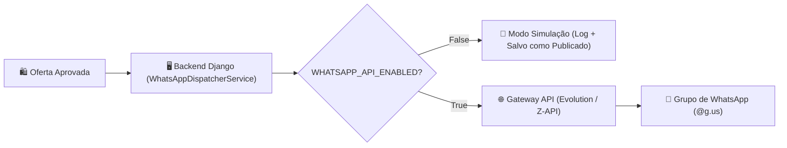

# 📱 Guia de Integração com WhatsApp (Evolution API & Z-API)

Este documento explica em detalhes como funciona e como colocar em produção o envio automático de ofertas para grupos de WhatsApp no **Santana Afiliados**.

---

## 📑 Sumário
1. [Visão Geral da Arquitetura](#1-visão-geral-da-arquitetura)
2. [Modo Simulação (Desenvolvimento Seguro)](#2-modo-simulação-desenvolvimento-seguro)
3. [Opção 1: Evolution API (Gratuita & Open-Source)](#3-opção-1-evolution-api-gratuita--open-source)
   - [Subindo com Docker](#subindo-com-docker)
   - [Criando a Instância e Lendo o QR Code](#criando-a-instância-e-lendo-o-qr-code)
   - [Descobrindo o ID do Grupo (`@g.us`)](#descobrindo-o-id-do-grupo-gus)
4. [Opção 2: Z-API (Cloud Comercial)](#4-opção-2-z-api-cloud-comercial)
5. [Configurando as Chaves no `.env`](#5-configurando-as-chaves-no-env)
6. [Como Usar no Painel Web](#6-como-usar-no-painel-web)
7. [Endpoints da API REST](#7-endpoints-da-api-rest)
8. [Boas Práticas Anti-Bloqueio (Meta / WhatsApp)](#8-boas-práticas-anti-bloqueio-meta--whatsapp)

---

## 1. Visão Geral da Arquitetura

O envio é realizado através de uma ponte intermediária (Gateway WhatsApp). O fluxo é:



Cada mensagem disparada contém:
- **Foto em Alta Definição** da mercadoria (Mercado Livre)
- **Título chamativo** com emojis promocionais
- **Preço Original vs Preço Promocional** com porcentagem de desconto
- **Condições de Parcelamento** e **Frete Grátis**
- **Link de Afiliado Oficial** formatado para clique rápido

---

## 2. Modo Simulação (Desenvolvimento Seguro)

Por padrão, a flag no `.env` vem configurada como:
```env
WHATSAPP_API_ENABLED=False
```
Nesse modo:
- Você **não precisa** de nenhum chip ou celular conectado.
- Ao clicar em **"Publicar Agora"** ou **"Disparar Próxima"**, o sistema simula o envio com sucesso.
- O payload completo (imagem, texto persuasivo e grupo de destino) é exibido no console do Django e gravado no banco de dados com data/hora de publicação.
- No topo da aba **Publicações**, você verá o banner indicando: `Status: Modo Simulação (Dry-Run Ativo)`.

---

## 3. Opção 1: Evolution API (Gratuita & Open-Source)

A **Evolution API v2** é a solução open-source mais estável e recomendada para bots de afiliados.

### Subindo com Docker

#### Via Docker Run direto:
```bash
docker run -d \
  --name santana_evolution_api \
  -p 8080:8080 \
  -e SERVER_URL=http://localhost:8080 \
  -e AUTHENTICATION_API_KEY=COLOQUE_UMA_CHAVE_ALEATORIA \
  -e DATABASE_ENABLED=false \
  -v evolution_instances:/evolution/instances \
  atendai/evolution-api:v2.2.3
```

#### Ou via Docker Compose:
```bash
cd docker
docker compose up -d evolution_api
```

Acesse o painel/documentação Swagger em: `http://localhost:8080/docs`

---

### Criando a Instância e Lendo o QR Code

1. **Criar a Instância:**
   Execute a requisição POST (via cURL ou Postman):
   ```bash
   curl -X POST "http://localhost:8080/instance/create" \
     -H "Content-Type: application/json" \
     -H "apikey: SUA_CHAVE_DA_EVOLUTION_API" \
     -d '{
       "instanceName": "santana-promos",
       "qrcode": true,
       "integration": "WHATSAPP-BAILEYS"
     }'
   ```

2. **Obter o QR Code:**
   Acesse no navegador:
   ```
   http://localhost:8080/instance/connect/santana-promos
   ```
   Abra o WhatsApp no seu smartphone > **Aparelhos Conectados** > **Conectar Aparelho** e escaneie o QR Code na tela.

---

### Descobrindo o ID do Grupo (`@g.us`)

Para listar todos os grupos em que o seu número participa:
```bash
curl -X GET "http://localhost:8080/group/fetchAllGroups/santana-promos?getParticipants=false" \
  -H "apikey: SUA_CHAVE_DA_EVOLUTION_API"
```
Na resposta JSON, copie o campo `id` correspondente ao seu grupo de promoções (ex: `SEU_GRUPO@g.us`).

---

## 4. Opção 2: Z-API (Cloud Comercial)

Se preferir não rodar containers locais e usar uma nuvem pronta:
1. Crie uma conta no [Z-API](https://www.z-api.io/).
2. Crie uma instância e leia o QR Code pelo painel web.
3. Copie o **Instance ID**, o **Token** e o **Client-Token**.
4. Configure as variáveis no seu `.env` conforme a próxima seção.

---

## 5. Configurando as Chaves no `.env`

No arquivo `.env` na raiz do projeto (`c:\projetos wilson\apivendas\.env`):

### Para Evolution API:
```env
WHATSAPP_API_ENABLED=True
WHATSAPP_GATEWAY_TYPE=evolution
WHATSAPP_API_URL=http://localhost:8080/message/sendMedia/santana-promos
WHATSAPP_API_TOKEN=COLOQUE_A_MESMA_CHAVE_ALEATORIA
WHATSAPP_GROUP_ID=SEU_GRUPO@g.us
```

### Para Z-API:
```env
WHATSAPP_API_ENABLED=True
WHATSAPP_GATEWAY_TYPE=zapi
WHATSAPP_API_URL=https://api.z-api.io/instances/SUA_INSTANCIA/token/SEU_TOKEN
WHATSAPP_API_TOKEN=SEU_CLIENT_TOKEN
WHATSAPP_GROUP_ID=SEU_GRUPO@g.us
```

> **Nota:** Se você modificar o `.env`, o servidor Django recarregará automaticamente as novas chaves.

---

## 6. Como Usar no Painel Web

1. Abra o frontend: `http://localhost:5173/publications`
2. No topo da página você verá o **Card de Status do WhatsApp Gateway**:
   - Status de conexão (Simulação ou Conectado)
   - Gateway ativo (Evolution / Z-API)
   - Grupo de destino configurado
   - Botão **"Testar Conexão"**: envia uma mensagem de teste imediata com data e hora para validar se as chaves estão operando.
   - Botão **"Disparar Próxima"**: busca a publicação aprovada mais antiga na fila e faz o disparo automático com 1 clique.
3. Em qualquer card de publicação:
   - Clique em **"Ver Detalhes / Publicar"**.
   - No modal, visualize o preview exato da mensagem e a foto do produto.
   - Clique no botão verde **"Publicar no WhatsApp"**.
   - O card atualiza instantaneamente para `Publicado` com badge verde e registro de envio.

---

## 7. Endpoints da API REST

O backend disponibiliza os seguintes endpoints para integração ou chamadas externas:

| Método | Endpoint | Descrição |
|---|---|---|
| `GET` | `/api/publications/whatsapp-config/` | Retorna o status atual do gateway, URL, grupo mascarado e modo de operação. |
| `POST` | `/api/publications/test-whatsapp/` | Dispara mensagem de teste para o grupo configurado. |
| `POST` | `/api/publications/{id}/publish/` | Publica uma oferta específica no grupo. Aceita `{ "group_id": "opcional" }`. |
| `POST` | `/api/publications/dispatch-next/` | Publica automaticamente a primeira oferta na fila de pendentes. |

---

## 8. Boas Práticas Anti-Bloqueio (Meta / WhatsApp)

Para garantir vida longa e segurança ao seu número de promoções:

1. **Evite números virgens recém-ativados:**
   Use um chip que já tenha pelo menos 2 a 3 semanas de uso comum (troca de mensagens com contatos).
2. **Defina intervalos seguros de disparo:**
   - Evite disparar 50 mensagens em 1 minuto.
   - O ideal é manter um intervalo de **30 a 60 minutos** entre cada oferta nos horários de maior engajamento (10h às 14h e 19h às 22h).
3. **Mantenha o grupo em modo "Apenas administradores podem enviar mensagens":**
   Isso reduz discussões paralelas e denúncias acidentais de membros.
4. **Use sempre fotos nítidas e links oficiais:**
   O sistema já formata a imagem oficial do Mercado Livre com `max_quality` e gera links diretos e limpos.
